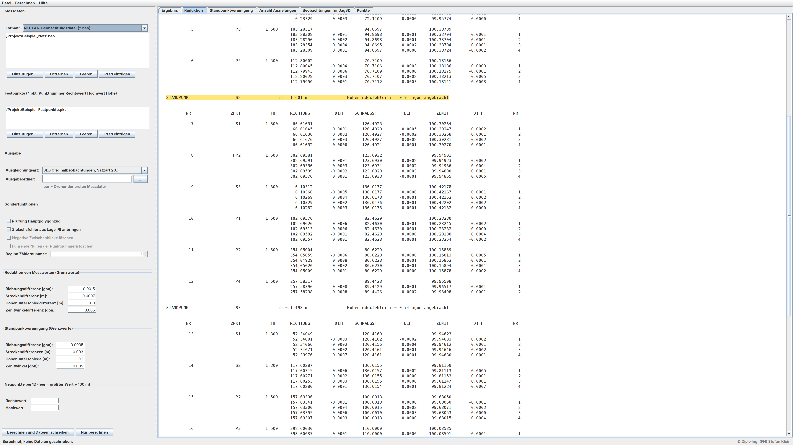

# beo-tool

**Reduktion von Messwerten, Standpunktvereinigung und Anzahl der Anzielungen** für
NEPTAN-Beobachtungsdateien (`*.beo`) und Nivellementdaten (Leica GSI, Trimble DAT) –
mit Ausgabe für die Netzausgleichung mit **Jag3D** (1D, 2D, 3D).

© Dipl.-Ing. (FH) Stefan Klein · MIT-Lizenz

[](docs/beo-tool_V1.00.png)

*beo-tool V1.00 mit dem Beispielnetz: Reduktion als 3D-Originalbeobachtungen mit Höhenindexfehler je
Standpunkt (Bild anklicken für volle Auflösung 5120 × 2880).*

## Download (Windows)

Unter [Releases](https://github.com/htw9056/beo-tool/releases) die Datei
`beo-tool_Vx.xx_Windows.zip` herunterladen, entpacken und `beo-tool.exe` starten.
Eine Java-Installation ist nicht nötig, die Java-Laufzeit ist im Paket enthalten.

## Funktionen

- **Einlesen:** NEPTAN-Beobachtungsdateien (Satzart 10/20, nichtreduzierte Messdaten),
  Leica GSI-8/GSI-16 und Trimble DAT (M5) vom Digitalnivellier, Festpunktdateien (`*.pkt`)
- **Prüfung Hauptpolygonzug:** nur Beobachtungen zwischen Standpunkten verwenden
- **Reduktion je Standpunkt:** Lage II auf Lage I, Horizontalstrecke und Höhenunterschied,
  Zielachsfehler aus Lage I/II, iterative Elimination von Ausreißern, Mittelbildung
- **Standpunktvereinigung:** gleichnamige Standpunkte über gemeinsame Ziele mit
  Orientierungsunterschied zusammenfassen, gewichtet nach Anzahl der Aufstellungen
- **Anzahl der Anzielungen:** unkontrollierte (nur einmal angezielte) Punkte erkennen
- **3D-Originalbeobachtungen (ab V1.00):** wahlweise gemittelte Schrägstrecke, Richtung und
  Zenitwinkel als Satzart `20.` mit Instrumenten- und Reflektorhöhe; Höhenindexfehler aus Lage I/II
  wird angebracht, Grenzwert Zenitwinkel 0.0050 gon
- **Ausgabe:** reduzierte Beobachtungen für Jag3D (`*.BEO` bzw. `Höhenmessung.NIV`),
  Fest-, Neu- und nicht verwendete Festpunkte, Protokolle
- Oberfläche und Aufruf in der Eingabeaufforderung (`beo-tool-konsole.exe`)
- Dateien und Protokolle im selben Aufbau wie das bisherige Excel-Werkzeug „Konvertierung für Jag3D“

Ausführliche Beschreibung: [Handbuch](src/beotool/hilfe/hilfe.html) (im Programm mit F1).

## Video-Anleitung

[**beo-tool_Anleitung.mp4**](docs/beo-tool_Anleitung.mp4) (4:26 min, ohne Ton, mit Untertiteln):
Schritt für Schritt vom Export im Feld bis zu den Dateien für Jag3D, Eliminieren fehlerhafter
Richtungen in der Rohdatei und warum das nötig ist, die Übersicht der größten Verbesserungen und die
Option 3D-Originalbeobachtungen (Satzart 20.). Das Video liegt auch jedem Release bei.

## Exportvorlagen für die Feldrechner

Im Ordner [`vorlagen`](vorlagen) liegen Vorlagen, mit denen die Feldrechner die Messungen direkt als
NEPTAN-Beobachtungsdatei (`*.beo`) exportieren:

- **Trimble Access:** [`vorlagen/Trimble/Neptan.xsl`](vorlagen/Trimble/Neptan.xsl) – Anleitung in
  [`vorlagen/LIESMICH.md`](vorlagen/LIESMICH.md)
- **Leica:** folgt

## Aufruf in der Eingabeaufforderung

```
beo-tool-konsole.exe -a 3D -p beispiele\Beispiel_Festpunkte.pkt beispiele\Beispiel_Netz.beo
beo-tool-konsole.exe -p beispiele\Festpunkte_Hoehe.pkt beispiele\Beispiel_Schleife.dat beispiele\Beispiel_Linie_angehaengt.gsi
beo-tool-konsole.exe -h
```

Die Beispieldaten im Ordner `beispiele` sind frei erfunden.

## Selbst bauen

Java 17 oder neuer:

```
./bauen.sh        (Linux)
bauen.bat         (Windows)
java -jar dist/beo-tool.jar
```

Das Windows-Paket mit eigener Java-Laufzeit und `beo-tool.exe` entsteht mit
`windows/paket_bauen.sh` (Linux-JDK, Windows-JDK, Go, Python 3) und wird bei jeder Änderung
auf `main` automatisch von GitHub Actions gebaut und als Release veröffentlicht.

## Kontakt

Fragen, Fehlermeldungen und Wünsche ausschließlich über das
[Forum (Discussions)](https://github.com/htw9056/beo-tool/discussions).

## Hinweis

beo-tool ist ein eigenständiges, unabhängig entwickeltes Programm. NEPTAN und Jag3D sind
Produkte ihrer jeweiligen Hersteller; die Namen werden nur verwendet, um die Dateiformate zu
beschreiben.
